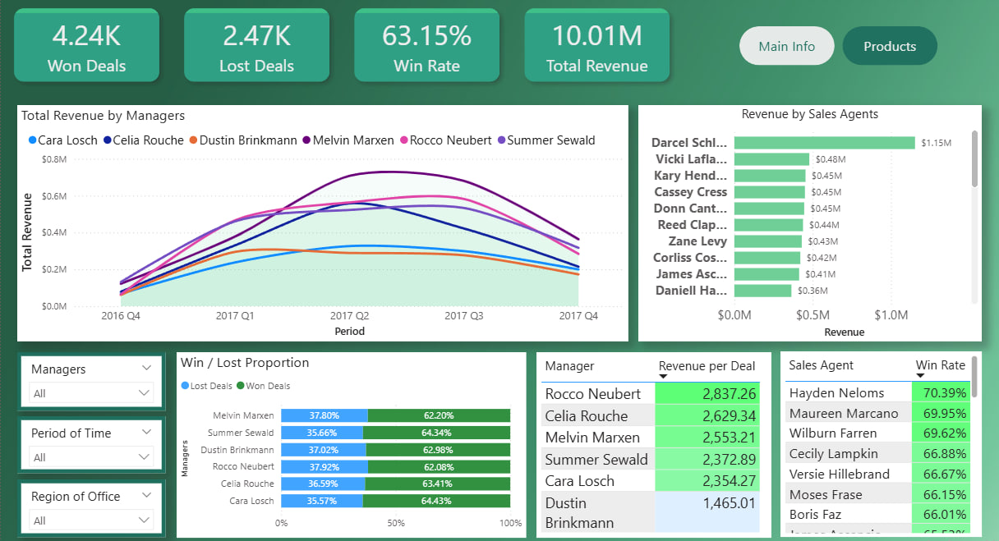
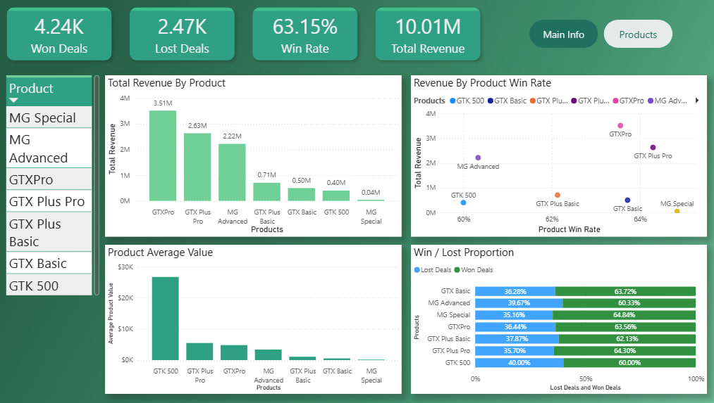

# Maven Sales Analysis

English version: [README.md](README.md)

Analýza CRM dát o predaji (manažéri, predajní agenti, produkty) pomocou SQL a interaktívneho dashboardu v Power BI.




## Cieľ projektu

Zistiť, ktorí manažéri, predajní agenti a produkty prinášajú najvyššie tržby, ako úspešne uzatvárajú dohody (win rate) a prečo sa tržby jednotlivých manažérov líšia.

## Motivácia: prečo práve tieto metriky

Metriky som zvolil tak, aby spolu ukázali silné a slabé stránky predajného tímu v rozdelení podľa manažérov, agentov a produktov:

- **Tržby** ukazujú rozsah: kto a čo prináša najviac peňazí.
- **Win rate** ukazuje kvalitu predaja: ako často sa otvorená dohoda skutočne vyhrá.
- **Priemerná hodnota vyhratej dohody** ukazuje hodnotu dohôd: či niekto vyhráva veľa malých dohôd, alebo málo veľkých.

Sledovať iba jednu z nich je zavádzajúce. Napríklad manažér s vysokými tržbami môže mať jednoducho viac dohôd a manažér s nízkou priemernou hodnotou dohody môže dohody uzatvárať rovnako úspešne ako ostatní.

## Dáta

Maven Analytics – CRM Sales Opportunities: 8 800 dohôd (opportunities), 30 predajných agentov, 6 manažérov, 7 produktov.

- 4 238 vyhratých dohôd, 2 473 prehratých, 2 089 stále otvorených (Prospecting / Engaging)
- Dohody v období Q4 2016 – Q4 2017; všetky tržby pochádzajú z dohôd uzavretých v roku 2017
- Použité tabuľky: `sales_pipeline` a `sales_teams`

## Nástroje a zručnosti

| Oblasť | Použité nástroje / pojmy |
|---|---|
| **Databáza a SQL** | PostgreSQL, Apache Superset (SQL Lab ako SQL editor, export výsledkov do CSV), `SELECT`, `WHERE`, `GROUP BY`, `ORDER BY`, `LEFT JOIN`, `CASE WHEN`, agregačné funkcie (`SUM`, `COUNT`, `AVG`), `NULLIF`, `ROUND`, pretypovanie (`::numeric`), CTE (`WITH`), `EXTRACT`, `TO_DATE` |
| **Power BI** | Power BI Desktop, Power Query (kontrola dát, dátové typy), DAX miery (`SUM`, `DIVIDE`), vypočítaný stĺpec, slicery, KPI karty, čiarový / stĺpcový / skladaný stĺpcový / bodový graf, zoradenie podľa iného stĺpca |
| **Analýza** | win rate, tržby, priemerná hodnota dohody, kohortová analýza podľa kvartálov, overovanie výsledkov (súčty medzi SQL a Power BI), problém malých vzoriek |
| **Ostatné** | GitHub, dokumentácia |

## Postup

1. Dáta uložené v databáze PostgreSQL (`sales_pipeline`, `sales_teams`).
2. Tri SQL dopyty napísané v Apache Superset SQL Lab: výkonnosť produktov, výkonnosť manažérov, výkonnosť agentov podľa kvartálov.
3. Overenie:súčet vyhratých tržieb napríklad vo všetkých dopytoch je **10 005 534 $**.
4. Výsledky dopytov exportované do CSV a načítané do Power BI.
5. Dátové typy nastavené v Power Query, miery vytvorené v DAX.
6. Vytvorený dvojstranový dashboard (Hlavná stránka, Produkty).
7. KPI na dashboarde skontrolované voči výsledkom z SQL.

## Definície metrík

| Metrika | Definícia |
|---|---|
| Vyhraté / prehraté dohody | počet dohôd so štádiom `Won` / `Lost` |
| Win rate | vyhraté / (vyhraté + prehraté); otvorené dohody sa nezapočítavajú, pretože ich výsledok ešte nie je známy |
| Tržby | súčet `close_value` vyhratých dohôd |
| Priemerná vyhratá dohoda (Revenue per Deal) | tržby / počet vyhratých dohôd |
| Obdobie | rok a kvartál, v ktorom bola dohoda otvorená (engage date) |

## Kľúčové zistenia

- Celkové tržby sú **10,01 M $** zo **4 238 vyhratých dohôd** (priemerná dohoda 2 361 $), win rate **63,15 %**.
- Tri produkty, GTXPro (3,51 M $), GTX Plus Pro (2,63 M $) a MG Advanced (2,22 M $), tvoria približne **84 %** tržieb.
- GTK 500 má najvyššiu priemernú hodnotu vyhratej dohody (**26 707 $**), ale len 15 vyhratých dohôd, takže jeho tržby sú iba 0,40 M $.
- Win rate je takmer rovnaký pri všetkých produktoch (60,3 – 64,8 %) aj manažéroch (62,1 – 64,4 %). Rozdiely v tržbách teda spôsobuje **počet a hodnota dohôd**, nie úspešnosť ich uzatvárania.
- Najvyššie tržby má Melvin Marxen (2,25 M $). Najvyššiu priemernú hodnotu vyhratej dohody má Rocco Neubert (2 837 $), najnižšiu Dustin Brinkmann (1 465 $).
- Najlepší predajný agent priniesol 1,15 M $, čo je viac ako dvojnásobok druhého v poradí (0,48 M $).

## Obmedzenia

- Obdobia sú zoskupené podľa dátumu **otvorenia** dohody, preto posledné kvartály vyzerajú slabšie: veľa týchto dohôd ešte nebolo uzavretých.
- Kohorta Q4 2016 je malá, jej čísla by sa nemali zovšeobecňovať.
- Výsledky pochádzajú z jedného datasetu a nevysvetľujú, *prečo* sa dohody vyhrali alebo prehrali.
## Štruktúra repozitára

```
maven-sales-analysis/
├── README.md
├── README.sk.md
├── screenshots/
│   ├── dashboard-main.png
│   └── dashboard-products.png
├── sql/
│   ├── product_performance.sql
│   ├── manager_performance.sql
│   └── agent_cohort_performance.sql
└── powerbi/
    └── maven_sales_dashboard.pbix
```
